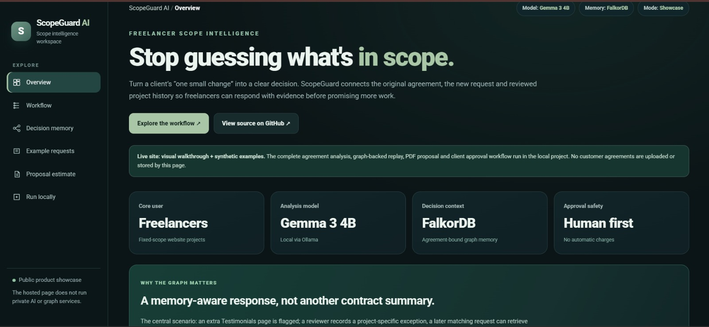
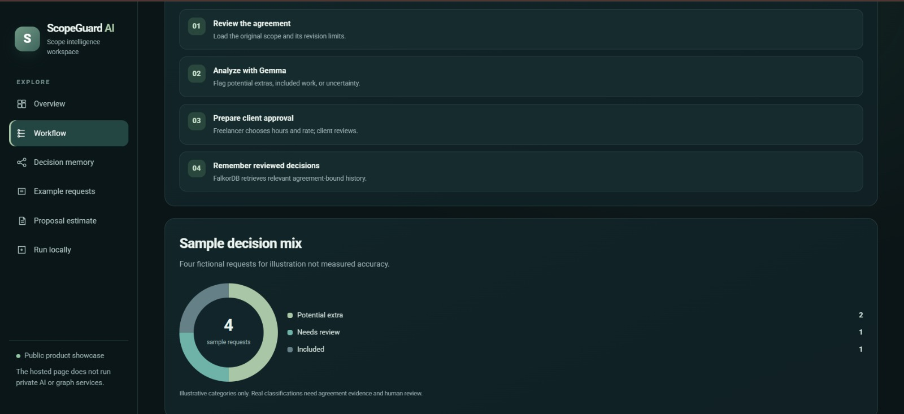
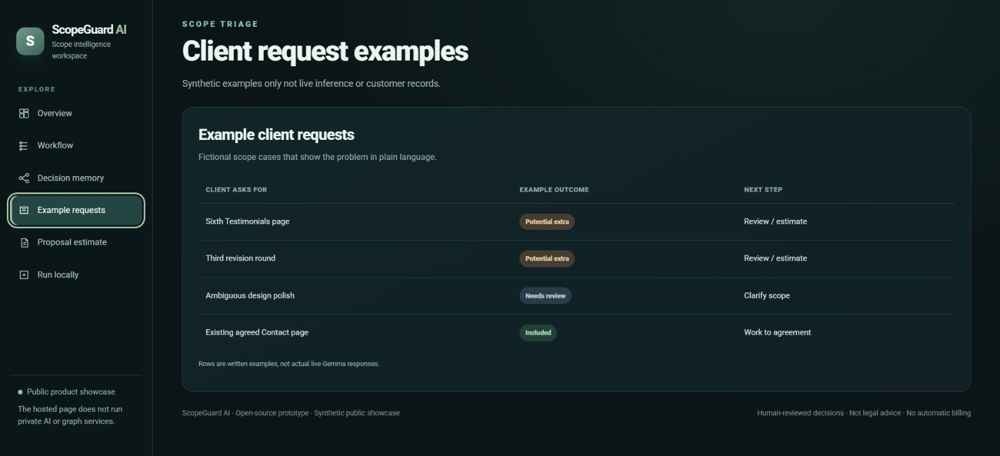
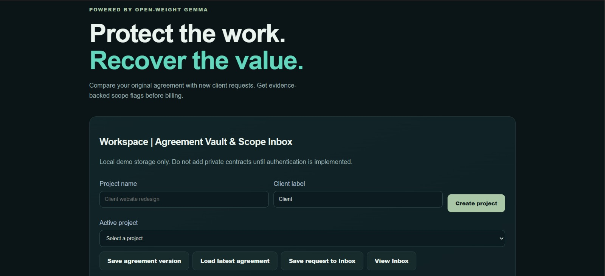
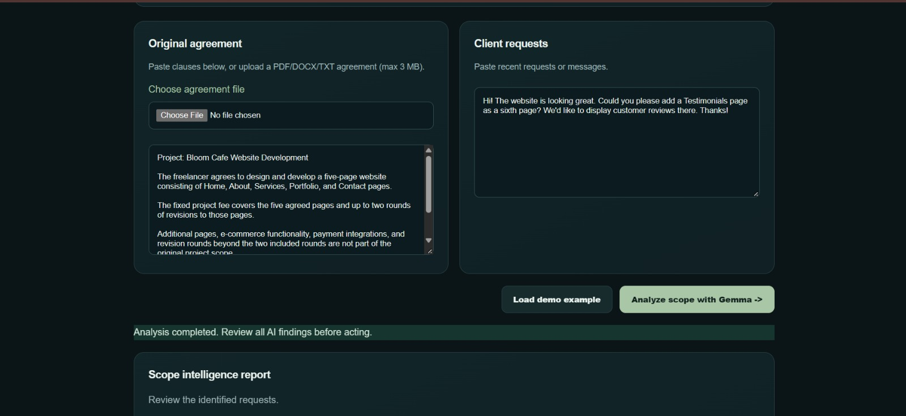
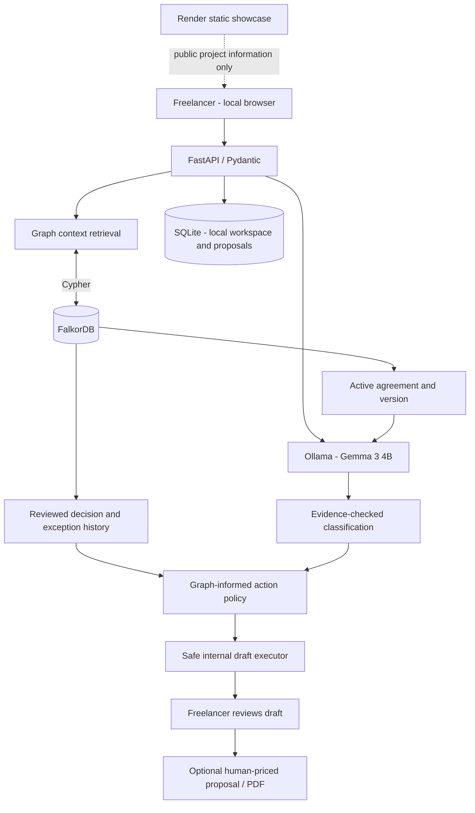
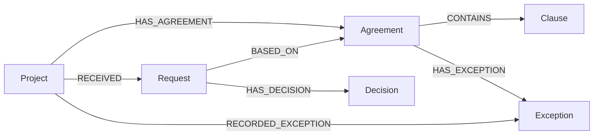

# 🛡️ ScopeGuard AI Atlas

### An agreement-aware AI agent that remembers what was promised and uses FalkorDB to decide what to do next.

**One request. Its full promise history.** ScopeGuard is a local-first, graph-informed scope-management assistant for freelancers building fixed-price websites. It connects the current agreement, incoming client requests, relevant contract clauses and human-reviewed exceptions so a freelancer can prepare the right next response **without inventing charges or treating AI output as customer consent**.

[](https://scopeguard-ai-508d.onrender.com/)

[](https://github.com/agcodes0315/Scopeguard-AI)

[](https://www.falkordb.com/)

[](https://www.wemakedevs.org/hackathons/falkordb)

> **Deployment boundary:** The public Render **static showcase** is https://scopeguard-ai-508d.onrender.com/. A separate **hosted FastAPI agent** is at https://scopeguard-atlas-api.onrender.com/ and has been verified with hosted FalkorDB and Ollama Cloud (`gemma4:cloud`). The hosted agent is protected by shared demo HTTP Basic authentication, not production-grade per-user authorization. The original local development path uses Gemma 3 4B. Use fictional data only.

---

## 🎯 The real-world problem

A freelance website developer signs a fixed-price contract for five pages: **Home, About, Services, Portfolio, Contact**. Days later the client asks for a **Testimonials** page or a third revision and calls it “a small change.” Later still, the developer may agree to waive the fee for that one specific request. New agreements, chat history, one-off exceptions and client approvals become scattered across records.

The freelancer needs to know more than **“Does this sound like extra work?”** They need to answer:

1. Which agreement **version** actually governs this request?

2. Which clause says what is included and what is outside scope?

3. Did we previously review **this specific request** and make an exception?

4. Does that exception still apply after an agreement update?

5. Should the next action be **a change-proposal draft, verification of an earlier exception, or a clarification request**?

A general-purpose language model can summarize a contract, but a summary alone does not reliably establish relationships between projects, versions, requests, reviewer decisions and consent. A project needs **connected, inspectable memory**.

### 👤 Who is it for?

| Persona | Context | Pain point | ScopeGuard's role |

|---|---|---|---|

| **Primary: solo freelance web developer** | Delivers fixed-scope sites for cafes, shops and local businesses | Unpaid revisions, ambiguous client requests, missing written context | Connect agreement evidence to a safe, client-ready next step |

| **Secondary: small web agency** | Manages several clients and recurring changes | Past concessions do not transfer cleanly across people or contract versions | Preserve project-specific, reviewer-acknowledged decision history |

| **Client (proposal reviewer)** | Wants clarity about a requested change | Unexpected costs or misunderstanding of what was agreed | Review an explicit, human-priced proposal rather than a surprise charge |

**Job to be done:** **“When a new client request arrives, help me find the controlling agreement, understand any relevant past promises and prepare an evidence-backed response before I commit to work or request payment.”**

---

## 🚀 What ScopeGuard does

ScopeGuard brings together five stages of the change-management process:

1. **Capture scope:** Paste or extract supported agreement text; maintain local project/workspace records and graph-backed agreement context.

2. **Analyze the request:** Open-weight **Gemma 3 4B**, served by **Ollama**, evaluates the request against agreement text. Supporting quotes are checked before treating an extra-work finding as sufficiently evidenced.

3. **Follow the graph:** **FalkorDB** links Project → Agreement → Clause, together with Requests, Decisions and Exceptions, so the active contract and its previous relevant history affect the result.

4. **Choose and execute a _safe internal_ action:** Graph-informed policy selects a proposal **draft**, exception **verification**, or clarification **draft**. These are reviewable internal outputs, **not automatic client messages, invoices or payment charges**.

5. **Obtain human review:** The freelancer supplies estimates and reviews the response; the separate proposal workflow can generate a customer-facing link and PDF. A synthetic approval demonstration is not proof of a legally binding signature.

### What makes it different?

**FalkorDB is not a decorative diagram.** The same request can lead to a **different next action** when the connected agreement history changes. It also prevents a Testimonials-specific exception from being reused for an unrelated online-store request.

---

## 🖥️ Product walkthrough and screenshots

Screenshots 1–3 show the public static showcase. Screenshots 4–5 show the operational workspace and agreement-analysis interface using fictional data. The static showcase does not execute inference; the separate hosted Atlas backend has been tested with FalkorDB and Gemma 4 Cloud.

### 1. Overview ScopeGuard AI



The overview introduces the freelancer-focused problem, the Gemma 3 4B analysis model, FalkorDB context, and the human-first safeguards.

### 2. Workflow Agreement to approval



The workflow page explains how agreement review, AI interpretation, proposal preparation, and graph-backed decision memory work together.

### 3. Example requests Scope decisions



The example-requests page shows illustrative scenarios for understanding how ScopeGuard handles different types of requests.

### 4. Workspace — Agreement Vault & Scope Inbox



The operational workspace lets a freelancer create a project, manage agreement versions, and organize incoming client requests.

### 5. Agreement vs. Client Request — Gemma Analysis



The agreement and incoming request appear side by side for evidence-based scope analysis. The example uses fictional client data; model output remains advisory and requires review.

---

## 🏗️ System architecture

The agent runs through FastAPI locally or on a separate Render web service. The public static showcase is a different deployment; the hosted agent uses FalkorDB and Ollama Cloud (`gemma4:cloud`).



**Trust boundary:** The static showcase serves illustrative content; the hosted FastAPI agent uses shared HTTP Basic demo access and hosted FalkorDB and Gemma inference. This is not per-user authorization or production-ready tenant isolation. Local SQLite workspace/proposal functionality is separate; use fictional data only.

### Responsibility by component

| Component | Responsibility |

|---|---|

| `frontend/` | Actual local agreement, graph, Atlas and replay interfaces |

| `backend/main.py` | FastAPI application, analysis, frontend routes, API composition |

| `backend/graph_context.py` | FalkorDB project, clause, request and reviewed-decision context |

| `backend/atlas.py` | Version-bound exception lookup and evidence path |

| Graph action policy / safe executor | Decide which **internal** draft or verification operation to perform |

| Ollama + Gemma | Open-weight natural-language interpretation of contract and request |

| SQLite | Local workspace/proposal persistence, **not** a replacement for graph memory |

| `showcase/index.html` | Static Render presentation; it does not host the AI stack |

---

## 🕸️ FalkorDB: graph model, traversal and action selection

### Graph schema



A **Project** may have multiple agreement versions. A request is evaluated against the relevant agreement, not against every clause and waiver ever recorded. Human-reviewed exceptions carry agreement context, request matching information and an explicit customer-approved **demo flag**. Historical exceptions tied to a different agreement are surfaced for review rather than automatically applied.

### Cypher queries used in the graph-backed workflow

**1. Retrieve the current agreement:**

```cypher
MATCH (p:Project {id:$pid})-[:HAS_AGREEMENT]->(a:Agreement)
RETURN a.id, a.version, a.body
ORDER BY a.version DESC
LIMIT 1
```

**2. Follow the agreement to its scope clauses:**

```cypher
MATCH (a:Agreement {id:$aid})-[:CONTAINS]->(c:Clause)
RETURN c.id, c.text
ORDER BY c.position
```

**3. Retrieve reviewer decisions connected to the same agreement:**

```cypher
MATCH (p:Project {id:$pid})-[:HAS_AGREEMENT]->(a:Agreement {id:$aid})
      <-[:BASED_ON]-(r:Request)-[:HAS_DECISION]->(d:Decision)
RETURN r.id, r.text, d.classification, d.reviewer_note, d.status
```

**4. Inspect historical and current agreement exceptions:**

```cypher
MATCH (p:Project {id:$pid})-[:HAS_AGREEMENT]->(a:Agreement)
      -[:HAS_EXCEPTION]->(e:Exception)
RETURN a.id, a.version, e.id, e.request_text,
       e.request_hash, e.effect, e.reason,
       e.customer_approved, e.status
ORDER BY a.version DESC
```

These queries correspond to graph patterns shown in the provided ScopeGuard implementation. The application uses Python-side conservative applicability checks; **it does not claim general-purpose semantic multi-hop reasoning or MCP orchestration**.

### Three decisive scenarios

| Connected context | Internal next action | Why it matters |

|---|---|---|

| New Testimonials request; no applicable prior exception; extra work supported by verified evidence | `prepare_change_proposal_draft` | Creates an **editable draft**, not an invoice |

| Same request after a current-agreement, reviewed exception is recorded | `verify_existing_exception` | Re-checks its terms and independent customer consent |

| New online-store/checkout request; Testimonials waiver is unrelated | `prepare_clarification_draft` if chargeability remains unverified | Does not reuse unrelated concessions or invent a charge |

These are **verified hosted API demonstration scenarios**, not guarantees about arbitrary contracts. The model can produce `needs_review` and conservative matching intentionally avoids silently treating paraphrases as equivalent approvals.

### Why a graph instead of only LLM context?

A transcript or vector-search result can retrieve similar words. ScopeGuard must also resolve **which project**, **which agreement version**, **which reviewer-confirmed decision** and **whether the exception actually applies**. Relationships and version boundaries are first-class. The graph informs the policy; the language model helps interpret new text. If FalkorDB is unavailable, graph-backed operations fail rather than silently inventing an unrelated decision history.

---

## 🎬 Demonstrable end-to-end sequence

A judge can reproduce the core action comparison using **fictional** data:

1. Create **Cafe Website** and the agreement: **“Home, About, Services, Portfolio and Contact pages. Two revisions included. Extra pages require separate written approval and pricing.”**

2. Send: **“Please add a Testimonials page.”** Inspect graph-informed action and exact agreement evidence.

3. Record a reviewer-acknowledged, agreement-specific exception for that exact request. Explicitly distinguish the synthetic approval flag from actual customer consent.

4. Repeat the same request. The agent should now select the **verification** path if the exception is applicable.

5. Send: **“Please add an online store with payment checkout.”** Confirm the previous Testimonials waiver does **not** carry over.

6. Show internal draft output and graph evidence; demonstrate a separately human-priced synthetic proposal and PDF where working.

**The punchline:** A changing graph state changes the agent's next safe action; it does not merely add extra text to a generic answer.

---

## 📊 Engineering proof and limitations

### Verified versus not yet measured

| Area | Evidence available | Interpretation |

|---|---|---|

| Automated tests | **85 passed** in a reported local run after safe-executor work | Regression results for that checkout; rerun before submission |

| Earlier Gemma evaluation | A **24-case synthetic dataset** and a historically reported **24/24** run | Exploratory evaluation, **not** 24 real customers; re-evaluate the current commit before citing as current |

| Cross-session graph behavior | Local request/exception replay and evidence paths shown | Demonstrates agreement-bound memory on synthetic data |

| Client-facing proposal | A synthetic **INR 4,000** example with customer approval and PDF demonstrated | No actual revenue recovered or legal authorization established |

| Public site | Render static showcase | Not a hosted operational agent |

| Real-user validation | No independently verified paying-user metrics included here | Still to measure; do not invent testimonial or conversion figures |

| Time to reviewed response | Not measured | Candidate north-star metric for future evaluation |

**North-star metric:** Time from receiving a client's change request to a **reviewed, usable client response**. Supporting metrics include evidence validity, false extra-work flags, agreement-version correctness, reviewer edits and rate of inappropriate exception reuse.

## 🎯 The Problem We Are Solving

### When a client says “just one small change,” who remembers what was originally agreed?

Freelance developers and small software agencies frequently work on fixed-price contracts with clearly defined deliverables, timelines, and revision limits.

Consider a freelance web developer building a five-page website for a café. The original agreement includes Home, About, Services, Portfolio, and Contact pages, with two rounds of revisions.

Midway through development, the client sends a message:

> “Can you also add a Testimonials page? It's just one small change.”

The technical implementation may be straightforward, but deciding how to handle the request introduces a business problem.

The developer must determine whether the request is already included, whether it requires additional pricing, whether a previous exception was approved, and what should be communicated to the client.

**The problem is not simply identifying scope creep. It is making the correct next decision when agreements, requests, and past decisions are scattered across different records.**

### Who Are We Building For?

**Primary user:** Independent web developers and freelance software engineers working on fixed-scope client projects.

**Secondary users:** Small web development agencies, design studios, and service businesses that regularly negotiate changes to agreed deliverables.

These users often manage multiple projects while handling client communication, technical development, pricing, and delivery themselves. They may not have dedicated project managers or contract administrators.

ScopeGuard is designed to help them answer three practical questions:

1. **What did I originally promise?** Find the relevant agreement terms and revision limits.

2. **Have we already made a decision about this request?** Retrieve applicable history under the correct agreement version.

3. **What should I do next?** Prepare a clarification, review an existing exception, or draft a transparent change proposal.

The goal is to reduce the effort required to reach an evidence-backed decision without removing human control over pricing or client approval.

---

## 💡 Our Solution ScopeGuard AI

### An AI-powered scope intelligence and decision-support workspace

ScopeGuard AI connects a freelancer's original agreement, incoming client requests, and human-reviewed project decisions into a traceable workflow.

Instead of relying on an AI model to interpret one isolated message, ScopeGuard uses **Gemma 3 4B for agreement analysis and FalkorDB for connected project context**.

The system is designed to help freelancers understand not just **what a client is asking**, but also **what the project history means for the next action**.

### How ScopeGuard Solves the Problem

**1. Establish the source of truth**

A freelancer creates a project and supplies the original agreement.

ScopeGuard stores the project, agreement and extracted clauses as connected graph records. This creates a foundation for checking future requests against the relevant contractual context.

**2. Examine the incoming request**

The freelancer enters a client message, such as a request to add a Testimonials page.

Gemma compares the request against the agreement and produces advisory classifications such as `included`, `potential_extra`, or `needs_review`.

The application validates supporting evidence rather than treating every model-generated statement as an unquestionable fact.

**3. Retrieve connected decision history**

FalkorDB connects projects, agreement versions, client requests, reviewer-confirmed decisions, and recorded exceptions.

Before choosing the next action, ScopeGuard checks whether the request has an applicable reviewed history.

A decision associated with an older agreement is not automatically reused, and an exception for one request must not silently apply to an unrelated request.

**4. Select a graph-informed next action**

ScopeGuard uses the retrieved graph state to determine a conservative next step.

For example:

| Situation | Next action |

|---|---|

| New request without an applicable recorded exception | Prepare a change-proposal draft when eligible |

| Matching customer-approved exception under the active agreement | Verify the existing exception |

| Unrelated request without verified chargeable scope | Prepare a clarification draft |

| Conflicting or outdated history | Require further human review |

This is the central technical distinction of ScopeGuard: **the connected graph changes the system's behavior instead of merely displaying background information.**

**5. Maintain human control**

The freelancer reviews the recommendation and independently estimates the required effort.

For verified additional work, ScopeGuard can support a client-facing change proposal, shareable review link, and downloadable PDF.

The application does not automatically charge the client, issue invoices, or treat an internal reviewer decision as sufficient proof of customer consent.

---

## 🧠 Why FalkorDB Is Essential

Traditional AI analysis focuses primarily on the current input. But a scope decision may depend on information recorded days or weeks earlier.

FalkorDB gives ScopeGuard a structured way to retrieve relationships among:

- The project and its active agreement

- Agreement versions and relevant clauses

- Client requests and previous decisions

- Recorded exceptions and customer-approval indicators

- The evidence used to explain the next action

For example, a Testimonials page might initially require a new scope assessment. If a human later records an applicable exception, the same request can lead to a different recommendation.

An online-store request should not inherit that Testimonials exception.

**This makes agreement-specific graph memory an operational dependency of the agent's decision process, rather than a decorative database integration.**

ScopeGuard currently uses conservative request matching and agreement-version checks. Broader semantic matching and more advanced multi-hop reasoning remain areas for future development.

---

## 📊 What We Have Demonstrated

ScopeGuard has been tested using fictional freelance-project scenarios designed to exercise its scope classification, graph memory, proposal, and safety workflows.

### Demonstrated technical outcomes

| Capability | Demonstrated outcome |

|---|---|

| Agreement-aware analysis | Gemma analyzes a client request against supplied agreement terms |

| Persistent decision context | FalkorDB retrieves previously recorded decisions |

| Graph-informed actions | The next recommended action changes when applicable graph history changes |

| Exception isolation | An unrelated online-store request does not inherit a Testimonials-specific exception |

| Human-governed pricing | Additional effort and hourly rates remain freelancer-controlled |

| Client approval workflow | A synthetic INR 4,000 proposal was generated, reviewed, and exported as PDF |

| Automated regression testing | 85 tests passed in a previously reported local run |

### What these results mean

The demonstrations establish that ScopeGuard can connect agreement evidence, graph context, and conservative action selection. The three scenarios were verified against the hosted FastAPI, FalkorDB and Gemma Cloud integration using fictional data.

They do **not** establish that the platform has already recovered actual freelance revenue, reduced project-management costs by a measured percentage, or achieved a particular real-world adoption rate.

Those outcomes require further user testing and measurement.

---

## 📈 Product Impact and Success Metrics

The primary goal is to make scope-change decisions faster, clearer, and more defensible.

### North-Star Metric

**Time from receiving a client change request to producing a reviewed, usable client response.**

This metric captures the workflow ScopeGuard aims to improve: understanding the request, retrieving the correct agreement, checking previous decisions, and preparing the response.

### Supporting Metrics

| Metric | Why it matters |

|---|---|

| Time to reviewed response | Measures the friction removed from the freelancer's workflow |

| Correct agreement-version retrieval | Ensures decisions use relevant contractual context |

| False additional-scope classification rate | Helps detect potentially unfair billing recommendations |

| Incorrect exception reuse rate | Measures the reliability of graph-bound decision memory |

| Human edits required for generated drafts | Evaluates how useful the prepared response is |

| Percentage of proposals receiving explicit client decisions | Measures whether the approval workflow helps complete the process |

These are product evaluation metrics, not claims of measured business impact.

### Next Validation Milestone

The next step is to invite freelance developers to complete the same fictional scope-change task with and without ScopeGuard.

Comparing task completion time, decision correctness, clarity of the final response, and perceived usability will help establish whether the prototype delivers measurable practical value.

---

## 🚀 What Makes ScopeGuard Different?

**ScopeGuard is not another chatbot that summarizes contracts. It is a graph-informed decision workflow for freelance scope changes.**

Its defining characteristics are:

- **Agreement-specific memory:** Prior decisions are connected to the agreement under which they were recorded.

- **Graph-informed action selection:** Different applicable histories can produce different next actions.

- **Traceable evidence:** Recommendations can expose the agreement and previous decision records used.

- **Conservative safeguards:** Unverified scope and unrelated exceptions do not silently become chargeable work.

- **Human-governed resolution:** Final pricing, consent verification, and client communication remain under human control.

- **Local-first open-weight AI:** Gemma runs through Ollama in the demonstrated local environment.

The long-term vision is straightforward:

**Help independent professionals protect their time, maintain client trust, and make informed decisions without losing track of what was promised.**

---

## 🧱 Technology stack

| Layer | Technology | Purpose |

|---|---|---|

| Frontend | HTML, CSS, JavaScript | Local operational interface and public product showcase |

| Backend | Python, FastAPI, Pydantic | API routes, validation, analysis and proposal services |

| LLM inference | Gemma 3 4B (local); `gemma4:cloud` (hosted) via Ollama | Agreement/request interpretation |

| Graph context | FalkorDB + Cypher | Version-aware project, clause, request and decision traversal |

| Local persistence | SQLite | Workspace and proposal records |

| Infrastructure | Docker Desktop / Docker Compose | Local FalkorDB instance |

| QA | pytest, synthetic evaluation dataset | Regression, evidence and safety tests |

| Hosting | Render static showcase and separate FastAPI web service | Illustrative presentation and authenticated demo agent |

**Separate contribution disclaimer:** Rust, Cargo, WSL2, GraphBLAS, LAGraph, RediSearch and Redis ACL research were involved in a **separate FalkorDB open-source issue investigation**. They are not presented as additional components or completed fixes in ScopeGuard's application.

---

## ⚙️ Run ScopeGuard locally

### Requirements

- Python 3.12 (the development environment used for the project)

- Docker Desktop, with Docker Compose available

- Ollama with the `gemma3:4b` model downloaded and running

- Enough local RAM/storage for the model

- PowerShell on Windows; other environments can use equivalent commands

```powershell
# Clone if you do not already have the repository
git clone https://github.com/agcodes0315/Scopeguard-AI.git
cd Scopeguard-AI
# Create a local Python environment and install dependencies
py -3.12 -m venv .venv
.\.venv\Scripts\python.exe -m pip install -r requirements.txt
# Start FalkorDB graph storage
docker compose -f compose.graph.yml up -d
# Ensure Ollama is installed/running and download the model once
ollama pull gemma3:4b
# Start the REAL local application (leave terminal open)
.\.venv\Scripts\python.exe -m uvicorn backend.main:app --host 127.0.0.1 --port 8001
```

If port 8001 is occupied, use `--port 8010` and replace `8001` in the URLs below; don't terminate other processes without checking which application owns them. Run Ollama separately in the background as required by your installation.

### Local application links

| Page | Local URL | What to demonstrate |

|---|---|---|

| Main workflow | http://127.0.0.1:8001/ | Agreement analysis, evidence, pricing and proposal |

| Atlas | http://127.0.0.1:8001/atlas.html | Version-bound exceptions and graph trace |

| Graph workspace | http://127.0.0.1:8001/graph.html | Human-confirmed decision memory |

| Decision replay | http://127.0.0.1:8001/replay.html | Graph-selected next-action demonstration, **if installed on your current branch** |

| API documentation | http://127.0.0.1:8001/docs | Inspect currently registered routes |

| Health | http://127.0.0.1:8001/api/health | FastAPI health response |

> **Troubleshooting:** A `404 Not Found` on a local page can mean an older app process is serving that port, or the route isn't included in the running checkout. Check the actual `/docs` route list and restart the intended server. A successful `pytest` run alone does not verify that your browser is connected to the latest process.

### Run tests

```powershell
.\.venv\Scripts\python.exe -m pytest -q
```

The last **reported** full local run passed **85 tests** with one nonblocking Starlette/httpx deprecation warning. The command above is the source of truth for your installed version. Do not use the historical test count as a current CI badge unless CI confirms it.

---

## ☁️ Public deployment versus local execution

**Public Render showcase:** https://scopeguard-ai-508d.onrender.com/

The Render service is a **Static Site** connected to `agcodes0315/Scopeguard-AI`, branch `main`, publishing `showcase/`. Commits to `showcase/index.html` can trigger a new static deployment when Auto-Deploy is enabled. Updating only `README.md` or the operational `frontend/` does **not** make the public showcase a live graph agent.

**Hosted agent (separate Render web service):** https://scopeguard-atlas-api.onrender.com/ — FastAPI, hosted FalkorDB, and Ollama Cloud (`gemma4:cloud`) returned successful graph-informed decisions in the synthetic three-scenario demonstration. Shared HTTP Basic demo credentials are required. **This is a prototype**, not production-grade authenticated multi-tenant software; persistent storage guarantees, individual user access control and independent customer consent verification remain limitations.

---

## 🗂️ Repository map

```text
Scopeguard-AI/
├── .github/                  CI workflows
├── backend/                  FastAPI, Gemma integration, graph and policies
├── frontend/                 Local operational pages, scripts and styles
├── showcase/                 Public Render static dashboard
├── tests/                    Automated regression and policy tests
├── evaluation/               Synthetic model evaluation tools/data
├── docs/
│   ├── 1.png … 5.png         README screenshots
├── tools/                    Development utilities, where applicable
├── compose.graph.yml         FalkorDB local container
├── Dockerfile                Backend image recipe (not the Render static site)
├── requirements.txt
├── start.ps1                 Windows launcher
├── start.sh                  Unix-like launcher
└── README.md                 Main project documentation
```

Generated files such as `.venv/`, `__pycache__/`, `.pytest_cache/`, local `data/`, secrets and database files must not be committed. Keep only necessary tools and docs; store unpublished blog/submission drafts separately if you prefer a minimal repository.

---

## 🔐 Safety, honesty and known gaps

- **Demo data only.** The hosted agent uses shared HTTP Basic demo credentials, not per-user authentication or tenant isolation. It is not suitable for private customer agreements on the public internet.

- **Not legal advice.** Language-model classifications can be wrong; supporting quotes and a human reviewer matter.

- **Review is not consent.** A freelancer's acknowledgement and a synthetic `customer_approved` flag are not independently verified contractual signatures.

- **No automatic billing or client outreach** from graph-selected actions. Pricing is entered by a human; proposals remain separate and explicitly reviewed.

- **Conservative matching.** Exact normalized request matching helps prevent inappropriate exception reuse, but does not solve general semantic equivalence.

- **Scope limitations.** No production multi-tenant auth, guaranteed graph persistence in the cloud, autonomous email dispatch or general MCP agent orchestration is claimed.

- **AI-assistance disclosure.** Development used AI coding assistance; validate the actual working implementation and preserve the repository's authentic history.

---

## 🏆 Graph Hacks 2026 submission

**Selected track:** **Track 01 Agents That Act on Connected Data**.

**Why it fits:** FalkorDB is essential to which agreement, version and prior exception the agent can consider. Those relationships influence a **concrete internal next action**, with a traceable evidence path and human review. This is stronger than attaching a graph image to an otherwise graph-independent chatbot.

**Source repository:** https://github.com/agcodes0315/Scopeguard-AI

**Public product showcase:** https://scopeguard-ai-508d.onrender.com/  
**Hosted agent (demo login required):** https://scopeguard-atlas-api.onrender.com/

**Demo video:** _Add your published video link after recording._

**Project blog:** https://lnkd.in/p/gg6Fxs8u

**Competition provenance:** The original ScopeGuard contract-analysis MVP preceded the event. The FalkorDB agreement/decision memory and Atlas graph-informed action work were the Graph Hacks additions. The public Git history is the authoritative record; final eligibility and judging are determined by organizers.

---

## 👩‍💻 Developer & contact

**Agrima Saxena** Software Engineering | Applied AI | Graph-based AI Systems

<table>

<tr>

<td width="60">

<a href="https://www.linkedin.com/in/agrima-saxena-142960426/" title="LinkedIn">


</a>

</td>

<td width="60">

<a href="mailto:agrimalc@gmail.com" title="Email">


</a>

</td>

<td width="60">

<a href="https://github.com/agcodes0315" title="GitHub">


</a>

</td>

</tr>

</table>

---

**ScopeGuard's principle:** **An agent should not just remember a decision. It should know which agreement made that decision applicable and choose the next action accordingly.**
