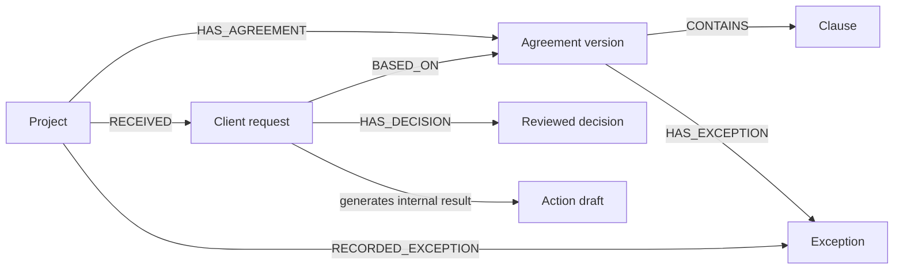
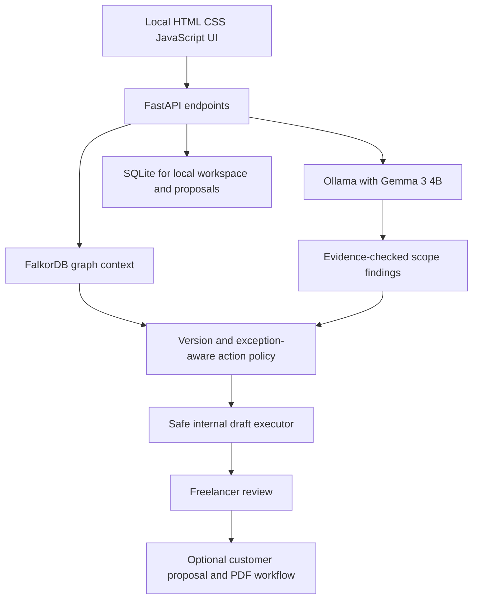

# 🛡️ ScopeGuard AI Atlas

### An agreement-aware agent that remembers what a client approved and changes its next action using FalkorDB.

**One request. Its full promise history.** ScopeGuard helps freelance web developers identify possible scope changes, review previous decisions, and prepare human-controlled client responses before additional work begins.

[](https://scopeguard-ai-508d.onrender.com/)
[](https://github.com/agcodes0315/Scopeguard-AI)
[](https://www.wemakedevs.org/hackathons/falkordb)

> **Hosted-site distinction:** The Render deployment is a **static showcase**. The actual FastAPI, Gemma/Ollama, FalkorDB graph agent, and proposal workflow run **locally**. The static page must not be presented as a live hosted AI agent.

## 🎯 Problem: where freelancers lose the thread

A client asks a freelance website developer to “just add one page.” The original contract allows five pages; a later message may have waived a fee for one specific change; meanwhile the agreement itself may have been revised. These facts often live in separate documents and chats. A plain LLM sees the current text but may not retrieve the correct **project**, **agreement version**, and **recorded decision**, or explain why earlier consent is or is not relevant.

**Primary persona:** A solo freelance web developer or small agency delivering fixed-scope websites to local businesses, with limited time for contract administration and no dedicated legal or project-operations staff.

**Job to be done:** “When a client asks for a change, help me quickly establish what the agreement says, what we decided before, and what safe response I should prepare not silently bill or promise new work.”

| Without ScopeGuard | With ScopeGuard Atlas |
|---|---|
| Search documents and message threads by hand | Traverse project → active agreement → relevant history |
| Risk applying a prior waiver to the wrong change | Match only applicable, agreement-bound exceptions |
| Manually reconstruct the rationale | Surface an evidence path and human review requirements |
| Reply without a consistent approval workflow | Prepare a draft or clarification, with pricing under human control |

**No time-savings, revenue-recovery, or accuracy claims are made without a measured user study.**

## 🧩 STAR: situation, task, action, result

| | Project explanation |
|---|---|
| **Situation** | Scope changes and past approvals are scattered across contracts and conversations. |
| **Task** | Help a freelancer make an explainable, version-aware decision about the next client request. |
| **Action** | Use Gemma for evidence-guided classification, FalkorDB to follow connected agreement and decision history, a conservative action policy, and an internal draft executor. |
| **Result demonstrated** | In local synthetic tests, different graph states select different internal next actions without automatically invoicing or sending messages. |

## 🧭 End-to-end product journey

1. **Create a project and agreement.** Store its clauses and version in FalkorDB.
2. **Paste a client request.** Retrieve the active agreement and matching reviewed history.
3. **Select a safe next action.** The graph state determines whether to draft a change proposal, verify a prior exception, or ask for clarification.
4. **Review evidence and draft.** The freelancer edits and approves a response; no payment or external message is sent automatically.
5. **Remember verified exceptions.** Store a human-reviewed decision with its agreement context for future matching requests.
6. **Handle changes safely.** New agreement versions and unrelated requests must not inherit old exceptions without review.

## 🏆 Graph Hacks 2026 Track 01

**Track:** *Agents That Act on Connected Data* (iPhone track).

**Core differentiator:** FalkorDB changes the agent's **selected next action**, not simply a secondary report. The graph context is an input to the action policy. When FalkorDB is unavailable, graph-backed operations report an error instead of silently substituting unrelated local memory.

### Three reproducible synthetic scenarios

| Connected graph context | Expected selected action | Safety |
|---|---|---|
| Testimonials request with **no matching exception** | `prepare_change_proposal_draft` when verified scope supports it | Internal draft only, human approval required |
| Same request with a **matching reviewed exception** on current agreement | `verify_existing_exception` | Check applicable conditions and independent customer consent |
| Unrelated checkout request with **no applicable exception** | `prepare_clarification_draft` when chargeability is not verified | No unsupported charge |

These are **conditional behaviors**, not guaranteed classifications for arbitrary model input. Matching is deliberately conservative. A `customer_approved` demo flag is not documentary proof of real-world consent.

### Graph data model



**Version boundary:** An exception tied to an older agreement is surfaced as historical/stale, not automatically reused with a newer agreement. Requests are matched conservatively to reduce incorrect waiver reuse.

### Representative FalkorDB/Cypher queries used by the application

**Get the active agreement** (`backend/atlas.py`, `backend/graph_context.py`):

```cypher
MATCH (p:Project {id:$pid})-[:HAS_AGREEMENT]->(a:Agreement)
RETURN a.id, a.version, a.body
ORDER BY a.version DESC
LIMIT 1
```

**Retrieve connected exceptions and their agreement versions:**

```cypher
MATCH (p:Project {id:$pid})-[:HAS_AGREEMENT]->(a:Agreement)
      -[:HAS_EXCEPTION]->(e:Exception)
RETURN a.id, a.version, e.id, e.request_text,
       e.request_hash, e.effect, e.reason,
       e.customer_approved, e.status
ORDER BY a.version DESC
```

**Retrieve earlier reviewed decisions tied to an agreement:**

```cypher
MATCH (p:Project {id:$pid})-[:HAS_AGREEMENT]->(a:Agreement {id:$aid})
      <-[:BASED_ON]-(r:Request)-[:HAS_DECISION]->(d:Decision)
RETURN r.id, r.text, d.classification, d.reviewer_note, d.status
```

Queries above illustrate the graph relationships used; check the live implementation files for the exact Cypher and any recent changes. The agent does **not** claim general-purpose semantic matching, MCP orchestration, or autonomous client communication.

## 🏗️ Architecture



FalkorDB stores connected project and decision context. SQLite is used for local workflow/proposal records; it is **not** a substitute for FalkorDB memory. The action executor is restricted to internal draft-producing operations; it must not autonomously send emails, collect money, or assert customer approval.

## 🧱 Technology stack

| Layer | Technology | Why |
|---|---|---|
| Interface | HTML, CSS, JavaScript | Lightweight freelancer workflow, no separate frontend build required |
| API | Python, FastAPI, Pydantic | Validated graph, analysis and proposal endpoints |
| Open-weight model | Gemma 3 4B via local Ollama | Inference without requiring a closed hosted API |
| Context and history | FalkorDB; Cypher queries | Linked project, agreement version, clause, request and decision history |
| Local workflow persistence | SQLite | Prototype project/proposal state |
| Demo infrastructure | Docker Compose | Local FalkorDB container |
| Tests | Pytest | Regression, billing safeguards and graph policy checks |
| Public presentation | Render static site | Informational dashboard; not the private agent API |

**Rust/Cargo, GraphBLAS, LAGraph, and RediSearch** relate to the separate FalkorDB open-source build/contribution workflow; they are **not claimed as app components** unless the application actually imports or uses them.

## 🛠️ Running the actual application locally

**Prerequisites:** Python 3.12, Docker Desktop, Ollama and enough RAM/storage for `gemma3:4b`.

```powershell
# Clone once
 git clone https://github.com/agcodes0315/Scopeguard-AI.git
 cd Scopeguard-AI
 py -3.12 -m venv .venv
 .\.venv\Scripts\python.exe -m pip install -r requirements.txt

# Start FalkorDB
 docker compose -f compose.graph.yml up -d

# In another terminal: ensure Ollama is running and model installed
 ollama pull gemma3:4b

# Start FastAPI on an available port
 .\.venv\Scripts\python.exe -m uvicorn backend.main:app --host 127.0.0.1 --port 8002
```

Open `http://127.0.0.1:8002/`, `http://127.0.0.1:8002/atlas.html`, `http://127.0.0.1:8002/graph.html`, `http://127.0.0.1:8002/replay.html` (when the Replay upgrade is installed), or `http://127.0.0.1:8002/docs` for the route list.

**If a port is occupied** (Windows `WinError 10048`), do not terminate unrelated processes blindly; run on a free port and use its matching URL.

Run tests:

```powershell
.\.venv\Scripts\python.exe -m pytest -q
```

Historical local evidence: **85 tests passed** before final UI integration, with one Starlette deprecation warning. Rerun on the current checkout; this document does not claim an unverified new test count.

## 🧪 Judge's two-minute test

1. In `/replay.html`, create a synthetic cafe website project. Confirm creation in FalkorDB.
2. Submit the Testimonials-page request. Inspect the selected action and traversed agreement path.
3. Save a synthetic reviewer exception for that **same request**; rerun to see `verify_existing_exception` instead.
4. Replace the text with “Please add an online store with payment checkout.” Verify the old waiver does not apply.
5. Change the agreement version (if the installed route supports it) and confirm stale history does not silently authorize an action.

Capture **real screenshots and responses**; never replace them with mock examples without labeling them illustrative.

## 🔐 Scope and safety

- **Synthetic data only** for the unauthenticated local demo. Do not upload real private contracts.
- AI decisions are advisory; this is **not legal advice**.
- Reviewer confirmation is **not automatically customer consent**.
- Unverified or included work is excluded from additional billing.
- No automatic client outreach, charges or invoices from the graph-action demo.
- Public Render page is not the hosted operational backend.
- Before production: authentication, project/tenant isolation, secure storage, durable graph hosting and consent evidence verification are required.

## 📁 Maintained repository structure

```text
Scopeguard-AI/
├── .github/                 # CI workflows
├── backend/                 # FastAPI, graph context, action policy, approvals
├── frontend/                # Local operational UI and forest theme
├── showcase/                # Render static product showcase
├── tests/                   # Automated safeguards and regression tests
├── evaluation/              # Model evaluation cases
├── docs/                    # Technical and submission documentation
├── tools/                   # Development utilities
├── compose.graph.yml       # Local FalkorDB
├── Dockerfile               # Backend container recipe
├── requirements.txt
├── README.md
├── start.ps1                # Windows local launcher
└── start.sh                 # Unix local launcher
```

Ignored generated directories such as `.venv/`, `.pytest_cache/`, `__pycache__/`, and `data/` are local artifacts and should not be committed.

## 📈 Validation and next steps

**Demonstrated:** Decision changes across the three graph states, conservative human-review safety, agreement-specific exceptions, and the existing regression suite. **Still to validate before production:** real freelancer usability, measured retrieval time, model latency under load, correctness against larger diverse agreements, access controls and persistent hosted graph availability.

**Graph Hacks development disclosure:** ScopeGuard originated as a scope-management prototype before the event. During Graph Hacks, agreement-bound FalkorDB decision context and the Atlas agent/action work were developed as the event contribution. Git history is preserved. The competition organizers not the author determine eligibility.

## 👩‍💻 Author

**Agrima Saxena** Solo developer · Software engineering · Graph-based AI systems


<table>
<tr>

<td width="60">
<a href="https://www.linkedin.com/in/agrima-saxena-142960426/" title="LinkedIn">

</a>
</td>

<td width="60">
<a href="mailto:agrimalc@gmail.com" title="Email">

</a>
</td>

<td width="60">
<a href="https://github.com/agcodes0315" title="GitHub">

</a>
</td>

</tr>
</table>
**ScopeGuard makes the next action traceable to what was actually agreed not what the model happens to remember.**

*If this project helps you think differently about agreement-bound agent memory, consider starring the repository.*
